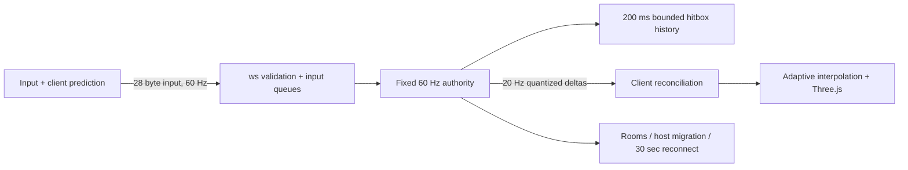

# PARALLAX — your body, someone else's eyes

A LAN multiplayer arena built for Syntax Error. Inspired by the existing Unity prototype's exchanged camera feeds, PARALLAX exchanges camera ownership inside one authoritative world. The original Unity code remains at the repository root.

## Run
Requires Node 20+ (tested on 24.13).
```sh
npm install
npm start
```
Open http://localhost:3000. The server prints LAN addresses and a QR. Every laptop uses the **same server URL**, then the same four-letter room code. Phones display the desktop-required notice. Allow the server through the private-network firewall if needed.

`npm run bots` fills a quick-match room with eight bots for ten minutes. For a human demo, join a room before starting bots; use the room capacity deliberately. Bots join the first available lobby. `PORT=...` is supported via environment variables.

## Play
Ready every player, then the host starts. WASD / mouse; Shift sprint; Space jump; Ctrl crouch; 1–4 pistol, SMG, shotgun, sniper; right-click scope; R reload; G short-range shock grenade; F3 diagnostics. Escape releases mouse. White minimap dot is your body; lime indicates borrowed eyes. Swaps arrive every 20–30 seconds with a countdown. Host selects rotation, pair, or on-kill swaps; two cover layouts, four live-synced palettes, deathmatch/team/LMS rules.

## Architecture

`shared/game.mjs` holds movement and ray/AABB logic. `shared/protocol.mjs` is shared by browsers, server and bots. Snapshot entities are 26 bytes; per-client caches avoid unchanged records; full frames repair state once per second. Interest radius is 55 m and always includes self and viewed entity. On these small arenas that often includes everyone. Server owns positions, ammo, fire cadence and damage. Rewind uses a client clock estimate clamped to 200 ms, never a client target claim.

Three.js 0.180.0 is vendored in `public/vendor`; ws and QR versions are pinned in package-lock. No runtime CDN or remote assets. Geometry and sound are generated. Characters use instancing. Render pixel ratio is capped, with automatic downgrade below 45 FPS for three seconds.

## Verification
```sh
npx playwright install chromium
npm test
npm run test:soak
```
Browser runner prefers the workspace `.browsers` installation when present; see TEST_REPORT.md for actual environment and results. Test fixtures own their child servers and stop them in `finally` blocks. Soak runs ten minutes plus four network conditions. Raw results are under `test-results` after execution.

## Deployment
`docker build -t parallax . && docker run --rm -p 3000:3000 parallax`

Render/Railway: deploy this directory as a Node service, `npm ci --omit=dev`, start `npm start`, enable WebSockets. Rooms are process-local: use a single replica or sticky room routing, not arbitrary load balancing. TLS is required for public hosting. Public adversarial deployment needs additional connection/IP admission controls and authentication.

## Honest boundaries
This is a tested hackathon prototype, not the entire requested production game. Arenas have solid cover and jumping, but no walkable raised platforms. Grenade is an immediate, nonlethal proximity shock, not a ballistic explosive. Themes use four generated canvas textures and material palettes. Sparks use a fixed pool and firing adds recoil. No gamepad, pooled decals, music loop, footsteps, animated weapon models, separate death-camera replay, team aggregate scoreboard, or cryptographic anti-cheat. Spawn selection maximizes distance but does not explicitly test all enemy sight lines. Render loops still allocate in some paths. The automated network harness measures transport and correction behavior; it cannot establish subjective playability. No claim of leak freedom from a ten-minute soak.


