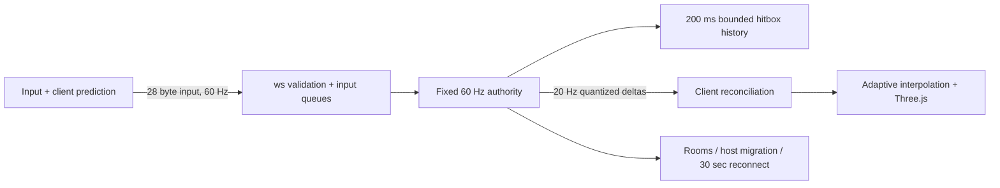
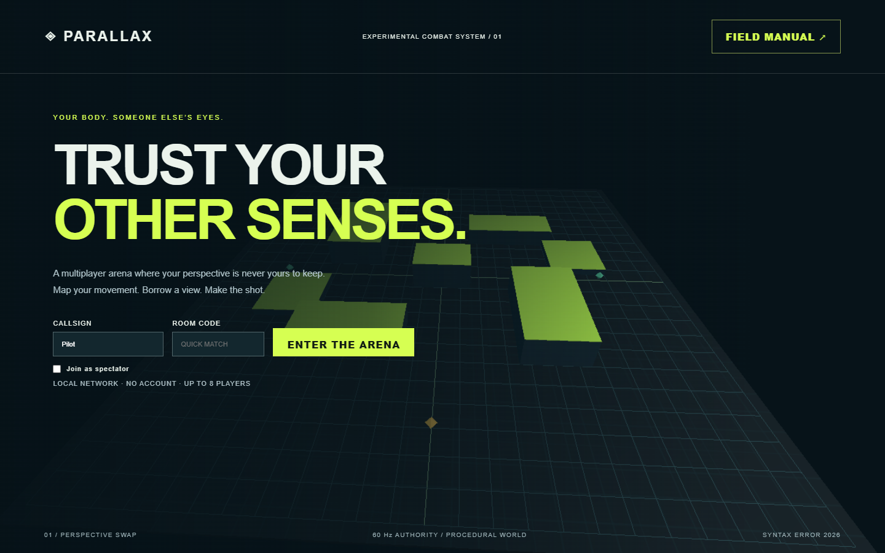
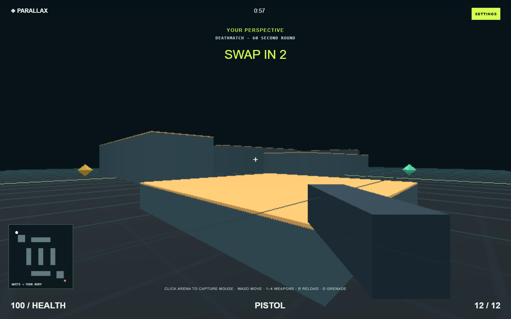

# PARALLAX — your body, someone else's eyes

A LAN multiplayer arena built for Syntax Error. Inspired by the existing Unity prototype's exchanged camera feeds, PARALLAX exchanges camera ownership inside one authoritative world. The original Unity code remains at the repository root.

## Run
Requires Node 20+ (tested on 24.13).
```sh
npm install
npm start
```
Open http://localhost:3000. The server prints LAN addresses and a QR. Every laptop uses the **same server URL**, then the same four-letter room code. Phones display the desktop-required notice. Allow the server through the private-network firewall if needed.

`npm run bots` fills a quick-match room with eight bots for ten minutes. For a human demo, join a room before starting bots; use the room capacity deliberately. Bots join the first available lobby. `PORT=...` is supported via environment variables.

## Play
Ready every player, then the host starts. WASD / mouse; Shift sprint; Space jump onto low platforms; Ctrl crouch; 1–4 pistol, SMG, shotgun, sniper; right-click sniper scope; R reload; G thrown grenade; F3 diagnostics. Escape releases mouse. Gamepad sticks, jump and triggers are also supported when the browser exposes a controller. White minimap dot is your body; lime indicates borrowed eyes.

Rounds last exactly 60 seconds: **5 seconds own POV, then 15 seconds borrowed POV**, repeated three times. Own POV has a five-second countdown with beeps. During borrowed POV the countdown stays hidden for 12 seconds, then counts down the final three seconds with beeps. The final countdown announces the end of the round. A distinct sound marks each camera change. Solo players retain their own camera.

Movement, aim, ammo and firing always belong to your original pilot. Simple world-space guns and muzzle sparks follow the actual shooter. When A sees through B's eyes, A's click flashes A's gun in the world, with no firing shake attached to B's camera. The camera wearer's own capsule is hidden to keep the view unobstructed; other living pilots remain rendered, including at close range. Deathmatch/team scores are tallied until time expires; LMS still eliminates without respawning but also runs to the timer. Host selects mode, one of two arenas and four themes. Spectators can cycle views.

## Architecture

`shared/game.mjs` holds movement, gun anchors and ray/AABB logic. `shared/protocol.mjs` is shared by browsers, server and bots. Snapshot entities are 28 bytes, including vertical velocity for correct jump reconciliation; per-client caches avoid unchanged records; full frames repair state once per second. The 80 m interest radius is checked around both body and camera, covering the entire current arena so pilots do not disappear at a distance threshold. Dynamic capsule and gun instances bypass stale aggregate frustum bounds. Server owns positions, ammo, fire cadence and damage. Rewind uses a client clock estimate clamped to 200 ms, never a client target claim. Shots originate at the shared gun muzzle; cover between body and muzzle blocks firing through a wall.

Three.js 0.180.0 is vendored in `public/vendor`; ws and QR versions are pinned in package-lock. No runtime CDN or remote assets. Geometry, textures, music and effects are generated. Characters and sparks use instancing. Render pixel ratio is capped, with automatic downgrade below 45 FPS for two seconds. The low tier deliberately reduces resolution to keep software rendering responsive.

## Verification
```sh
npx playwright install chromium
npm test
npm run test:soak
```
Browser runner prefers the workspace `.browsers` installation when present; see TEST_REPORT.md for actual environment and results. Test fixtures own their child servers and stop them in `finally` blocks. Soak runs ten minutes plus four network conditions. Raw results are under `test-results` after execution.

## Deployment
`docker build -t parallax . && docker run --rm -p 3000:3000 parallax`

Render/Railway: deploy this directory as a Node service, `npm ci --omit=dev`, start `npm start`, enable WebSockets. Rooms are process-local: use a single replica or sticky room routing, not arbitrary load balancing. TLS is required for public hosting. Public adversarial deployment needs additional connection/IP admission controls and authentication.

## Honest boundaries
This is a hackathon game, not a hardened public competitive service. It has low platforms, thrown grenades, generated textures/audio, recoil, death cam, team totals, and sight-line-aware spawns. Missing production features include animated weapon models, bullet impact decals, reliable source authentication for lag-compensation timestamps, persistent accounts, and cross-process room routing. The input server validates movement, ammo, rate, damage and line of sight, but determined users on an unauthenticated LAN can still manipulate aim or identity. Render loops still allocate in some paths. The network harness measures transport and corrections; subjective playability requires human players. A finite soak does not prove leak freedom.




